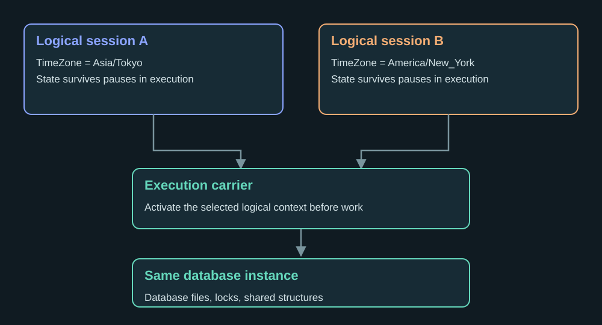

# How PostGamma Runs PostgreSQL in WebAssembly

A PostgreSQL backend can spend its whole life waiting for commands, executing
queries, and waiting again. A browser page cannot do that on its main thread
without losing the ability to respond to the user.

That difference shapes the browser build of PostGamma. Compiling the C code
is one part of the work. The more interesting questions are where the work
runs, who owns its state, and how a blocked operation can be interrupted.

The [browser preview](04-postgresql-in-your-browser-with-postgamma.md) runs
PostgreSQL 19 and upstream psql locally. This article describes the boundaries
behind that terminal, rather than treating a successful compilation as the
whole port.

## Threads make state ownership explicit

PostgreSQL normally gives each connection a backend process. A variable with
process lifetime can therefore belong to one backend without the C declaration
saying so explicitly. Put several backends in one address space, and that
assumption needs attention.

Consider session configuration. If one connection changes its time zone,
another connection must not silently inherit that setting. At the same time,
connections to the same database need to share the database's buffer and lock
management. Making every global variable thread-local would not express both
requirements.

PostGamma handles this through reviewed ownership rules and source
transformation. Clang identifies declarations and accesses; rules determine
which state belongs to a session, an instance, a tool invocation, or a
synchronized shared owner. A runtime supplies the corresponding storage and
lifecycle operations. I described the general approach in
[Threading PostgreSQL Without Editing Upstream Source Code](02-threading-postgresql-without-editing-upstream-source-code.md).

The browser build reuses that foundation. It does not maintain an independently
rewritten SQL parser or executor. It also does not assume that browser threads
behave exactly like processes on a Linux host.


## Follow one setting across two sessions

Here is the ownership invariant in observable terms. `a` and `b` are two
connections opened on the same SDK database instance:

```js
const a = await db.connect('session-a');
const b = await db.connect('session-b');
try {
  await a.query("SET TIME ZONE 'Asia/Tokyo'");
  await b.query("SET TIME ZONE 'America/New_York'");
  console.log((await a.query('SHOW TIME ZONE'))[0].rows[0][0]);
  console.log((await b.query('SHOW TIME ZONE'))[0].rows[0][0]);
} finally {
  await b.close();
  await a.close();
}
```

The expected values are `Asia/Tokyo` and `America/New_York`. Both connections
can see the same committed tables; they must not overwrite each other's
session configuration. The example isolates one property of session state,
not every property of transaction isolation.

<figure class="pg-article-figure">
  
  <figcaption>State owner and execution carrier are different concepts. This is an ownership diagram, not a fixed Worker allocation.</figcaption>
</figure>

<section class="pg-lab" data-blog-lab="ownership" aria-labelledby="ownership-model-title">
  <h3 id="ownership-model-title">Walk through the context switches</h3>
  <p>Explanatory model: no database starts here. Step through the two settings and then resume each logical session.</p>
  <div class="pg-lab-sessions">
    <div class="pg-lab-session" data-session="a"><strong>Session A</strong><code data-zone="a">UTC</code></div>
    <div class="pg-lab-session" data-session="b"><strong>Session B</strong><code data-zone="b">UTC</code></div>
  </div>
  <div class="pg-lab-carrier" aria-hidden="true"><i></i><span>Activate context → execute → yield</span></div>
  <div class="pg-lab-controls"><button type="button" data-next data-enable disabled>Next context switch</button><button type="button" data-reset data-enable disabled>Reset model</button></div>
  <output aria-live="polite">Both sessions begin in UTC. The shared database is the same; their settings have separate owners.</output>
</section>

Why not just use C thread-local storage? A physical carrier thread is an
execution resource. A logical session's state has to survive the intervals
when that session is not running, and the runtime may schedule work through a
pool. If the only owner were the physical thread, the next session using that
carrier could observe the previous session's values. A thread-local pointer
can identify the active context; it does not, by itself, define the lifetime
of all state reachable through that context.

The reviewed GUC pipeline is relevant here. The ownership policy classifies
built-in GUC storage as managed state; the generator combines catalog and AST
facts rather than treating every variable whose name resembles a setting as
an independent global. Inspect
[`project_guc_storage.py`](https://github.com/postgamma/postgamma/blob/c752f8ca5bdb5b801b26de586defc630cf6f5839/buildsys/project_guc_storage.py)
and the [GUC transition policy](https://github.com/postgamma/postgamma/blob/c752f8ca5bdb5b801b26de586defc630cf6f5839/manifests/ownership/backend-guc-transitions.json)
for the actual decisions. The diagram simplifies this pipeline into its
observable ownership contract.

| Object | Required lifetime or identity | Failure to look for |
|---|---|---|
| Connection's settings | The logical session | A setting leaks into another connection |
| Database files and shared database structures | The database instance | Sessions see unrelated databases, or shared structures are duplicated incorrectly |
| Active context on a carrier | The current unit of execution | A resumed operation uses another session's state |
| A tool such as psql | Its tool invocation | Reset starts with stale terminal or client state |

## Keep the page out of the blocking path

The page renders controls and results. PostgreSQL executes in Workers, using
Emscripten's pthread support and shared WebAssembly memory.

A simplified view looks like this:

```text
Browser page
    | requests, results, cancellation
    v
Control Worker
    |
    +-- PostgreSQL session work in pthread Workers
    +-- Shared database and runtime state
    +-- Filesystem and browser storage adapters
```

This is a responsibility diagram, not a promise of one browser Worker per SQL
statement. The configured pool includes infrastructure and other runtime work.
The preview supports four SQL connections and a bounded pool of parallel query
workers; those are different limits.

The distinction matters for a query that waits. The page must remain able to
request cancellation even while PostgreSQL is busy. Connection startup and
teardown also need to yield at the right boundaries, so that one lifecycle
operation does not prevent another connection from making progress.

The browser SDK has a
[dedicated lifecycle implementation](https://github.com/postgamma/postgamma/blob/c752f8ca5bdb5b801b26de586defc630cf6f5839/wasm/src/api/database.ts),
and the runtime has
[target-specific thread and wait support](https://github.com/postgamma/postgamma/tree/c752f8ca5bdb5b801b26de586defc630cf6f5839/runtime/platform/emscripten).
These are parts of the database integration, not UI timing tricks.


## Cancellation is also an ownership problem

Imagine a request that starts, times out at the page, and finishes later in a
Worker. Rejecting its JavaScript promise does not prove that the native
operation released its payload, request slot, or connection state. Reusing
those owners too early can deliver an old result to a new operation.

The transport gives admitted operations a monotonically increasing sequence
number and keeps a pending entry for each outstanding call. Incoming replies
look up that sequence; a reply for an already retired sequence is ignored.
The actual handler contains this guard:

```js
const waiter = this.pending.get(data.sequence);
if (!waiter) return; // Retired sequence: never deliver it to a later request.
```

Connection handles also carry generations. The sequence identifies an
operation; the handle generation identifies the lifetime of the object it
uses. They prevent different kinds of accidental reuse.

On instance failure, the transport stops admitting work and asks the control
Worker to discard the instance. It normally waits for cleanup acknowledgement
before rejecting the pending callers. If cleanup cannot acknowledge within its
own bound, it retires the Workers. That is why “cancel the UI spinner” is not
the resource contract.

<div class="pg-technical-note" markdown="1">
**Two deadlines, two questions.** An operation deadline asks whether the
caller is still willing to wait. Retirement asks whether the runtime can
safely release or replace its owners. A timeout message alone answers only
the first question.
</div>

The relevant source is the `Transport` implementation in
[`database.ts`](https://github.com/postgamma/postgamma/blob/c752f8ca5bdb5b801b26de586defc630cf6f5839/wasm/src/api/database.ts)
and the listener/deadline ownership in
[`OperationControl`](https://github.com/postgamma/postgamma/blob/c752f8ca5bdb5b801b26de586defc630cf6f5839/wasm/src/api/control.ts).
The excerpt is an implementation detail of this revision, not an SDK API to
call from an application.

## The upstream checkout remains an input

A portable build still needs changes to assumptions about the operating
system. The browser target has no native socket server to launch and no
ordinary operating-system process boundary for each backend.

PostGamma exports the pinned PostgreSQL revision into a generated source tree.
The Wasm build applies reviewed target adaptations there. For example, the
shared-memory configuration must select the provider implemented by the
browser runtime.

Those adaptations check the source shape and record input and output hashes.
If an expected source pattern changes, generation stops for review. It does
not silently accept an unmatched replacement. The
[source adaptation rules](https://github.com/postgamma/postgamma/blob/c752f8ca5bdb5b801b26de586defc630cf6f5839/buildsys/wasm_source.py)
show the checks and the reasons for each change.

Keeping the upstream checkout unchanged does not mean the resulting PostgreSQL
binary is unmodified. The transformations and runtime are exactly what make
this execution model possible. Keeping the input separate makes that work
inspectable and repeatable.

## Persistence needs a storage contract

Memory storage is useful for an interactive demonstration. Once the instance
is discarded, its database is gone. That is the mode used by the homepage's
psql terminal.

OPFS is a separate option. It lets the engine keep database files in storage
owned by the browser origin. PostgreSQL still manages pages, transactions, and
WAL; an adapter maps the required file operations and storage barriers to the
browser environment.

A successful synchronous COMMIT waits for the browser storage barriers used
by this implementation. That statement has a limit: closing a tab to test
recovery does not prove hardware power-loss durability. Likewise, a correct
WAL recovery path does not prevent the user from clearing the site's data or
the browser from evicting best-effort storage.

There is also an ownership question across tabs. The preview allows one live
owner of a named OPFS database at a time. Opening the same name in another tab
must wait or return a lock error. It must not create two independent buffer
managers writing to the same files.

These constraints belong in application design. A local database still needs
an export path and a clear explanation of what deleting browser data means.

## A terminal and an SDK share the engine, not every lifecycle

The Live terminal uses real psql and its matching private libpq. Their protocol
traffic stays inside the browser through an in-memory transport. There is no
remote SQL server behind the prompt.

That preserves familiar behavior: continuation prompts, backslash commands,
COPY input, result formatting, and transaction state. The page provides
terminal rendering and keyboard handling.

It does not make shell commands available. Nor does it make network connection
strings work. The terminal currently owns its database instance; applications
should not mix its lifetime with SDK connections to that same instance. The
SDK is the interface for an application that wants to manage its own queries,
results, storage choice, and close sequence.

## Test the boundaries, not just the demonstration

A useful browser test has to get past the first query. Can another connection
continue while one connection waits? Can a query be cancelled and the session
reused? Does a committed record survive reopening an OPFS database? What happens
if a tab disappears before a COMMIT reply arrives?

PostGamma has separate gates for these behaviors, plus tests of the packaged
SDK in Chromium, Firefox, and Linux WebKit. A pass in Linux WebKit does not
establish physical Safari or mobile-device support.

A later article will describe how the weekly suite keeps those results
attributable: which source revision ran, which package was installed, and which
checks really finished. The [browser guide](../../getting-started/browser.md)
documents the current API and deployment requirements.
